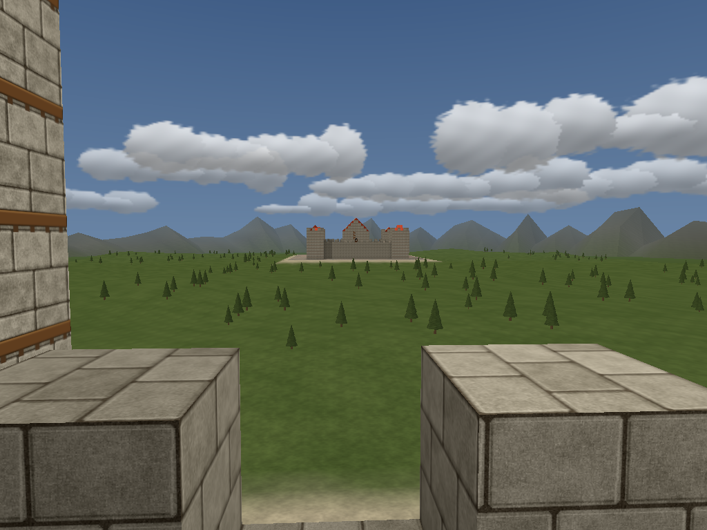
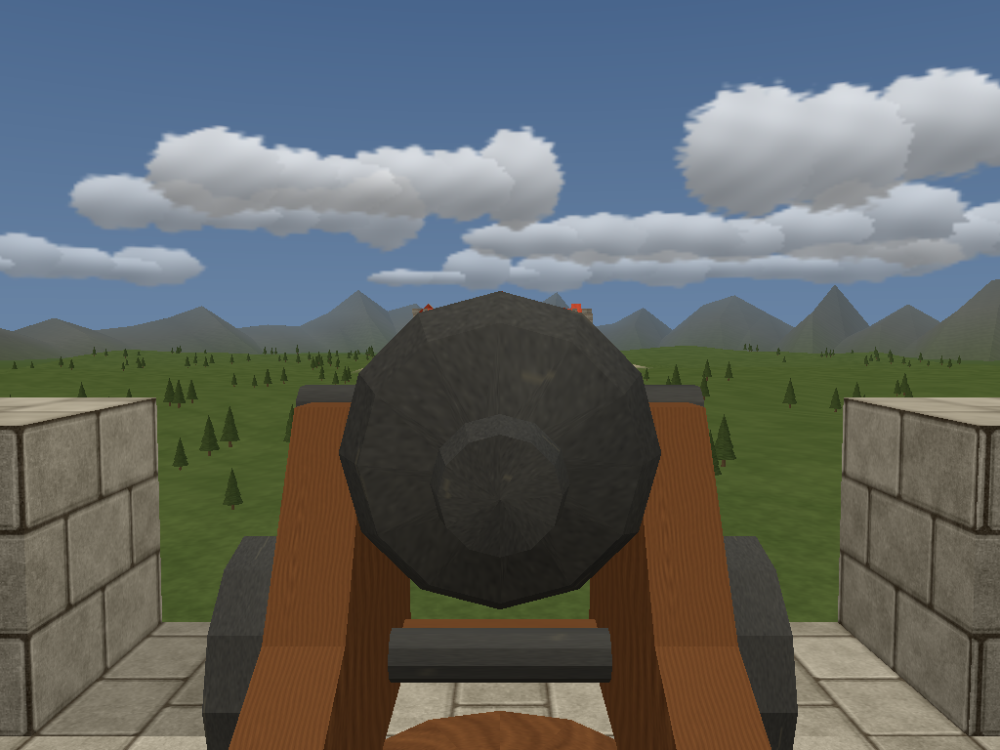
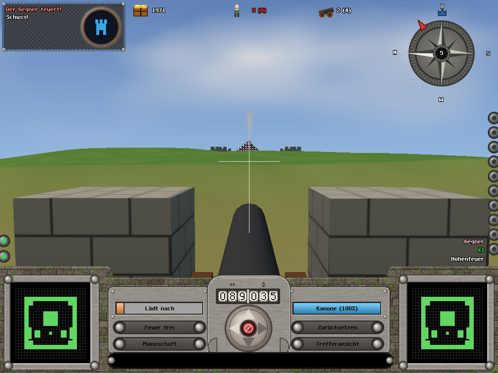

# Hohenfeuer

Hohenfeuer is a real-time, first-person-only castle artillery duel in three.js, re-imagining
*Ballerburg: Castle Siege* (Ascaron, 2001). Castles are coarse block structures; you play the
mortal ruler walking your own ramparts, designating blocks, weapons and repairs, and manning guns or
ordering crews. NPCs gate everything: gun crews, ammo runners, masons, and civilians as population
and hit points, with one morale number per castle. Opponents are AI castles in slots that humans can
take over. Weapons, NPC types, maps and blocks are plugins.

**Status (2026-10-18, early morning):** tracer bullets 1-4 work end to end in the browser: walk the
ramparts among civilians and gun crews, man a cannon with its crew, aim with the original's
direction/charge readouts and its ballistics (fixed elevation, powder charge, gravity, drag, scatter,
splash, wind), fire, hit the enemy castle, watch walls take damage states, and the AI orders its
crews and fires back. Designation building by masons, all ten original weapons as plugins, the
original's 145 castle layouts as block castles with forest/desert/ice/volcano biomes, a title menu
with skirmish setup and an end screen, classic and modern render presets, first-person feel (recoil,
shake, head bob) and an onboarding ramp (match 1 shows only the cannon, prompts retire as you use
them) are in. Gameplay is run as a critic-repair loop against a 22-criterion rubric
(`research/15`): critique v1 scored 52/110, repair wave 1 (`research/17`) fixed economy scarcity,
match shape and slot fairness (40 paired AI duels: 12-17 min, slot wins 20/20, gold never at cap);
critique v2 is in progress. See `HANDOFF.md` and `docs/worklog/`.

| Rampart, looking north | Weapon view | First shot (scripted golden) |
|---|---|---|
|  |  |  |

## Run

    npm install
    npm run dev            # vite dev server, open the printed URL
    npm run build          # production build to dist/
    npm test               # unit tests (node --test): sim, npc, ai, plugins, ui, rules
    npm run test:browser   # headless chromium (SwiftShader), writes test-results/
    npm run goldens        # capture/compare fixed-pose screenshots (tests/goldens/poses.json)

The browser tests need Playwright's chromium: `npx playwright install chromium`.
Controls (Phase 1): WASD + mouse to walk, E to man a cannon, arrow keys / PgUp PgDn to aim, Space to
fire, Esc for the menu. The sim runs at 30 Hz with 120 Hz projectile substeps and is deterministic.

## How it is built

- `docs/DESIGN.md` is the binding design (world, sim, NPCs, player, AI slots, rendering, plugins,
  module ownership, engineering rules, phase plan). `src/contracts.js` and `src/tuning.js` are the
  integration points every module imports from.
- Pure simulation (`src/core`, `src/world`, `src/sim`, `src/npc`, `src/ai`) never imports three.js
  or the DOM; `tests/unit/rules-purity.test.js` enforces it. Rendering (`src/render`), player and
  UI (`src/player`, `src/ui`, `src/audio`) are the IO edge.
- Development is orchestrated by Claude Code with parallel agents (Claude Opus/Sonnet and OpenAI
  Codex) working in disjoint lanes, in tracer-bullet slices, each with a golden screenshot and a
  headless test. Briefs and reports are in `codex-logs/`; `CLAUDE.md` holds the laws.
- Blender 4.5 scripts in `tools/blender/` generate the block kit and weapon models (`assets/`).

## Research and the original game

`research/` records the scoping decisions, ground truth about the 2001 game, the reverse-engineered
container formats of its CD (`scripts/rip/`, clean-room format tools), the manual's mechanics, and
the static analysis of its ballistics. The original game's assets, screenshots, manual text and
UI sheets are used only as local references (`assets-ripped/`, git-ignored) and are never
redistributed here; everything shipped in `assets/` and `src/` is re-authored. Ballerburg is a
trademark of its owners; this project is an independent fan re-imagining.
