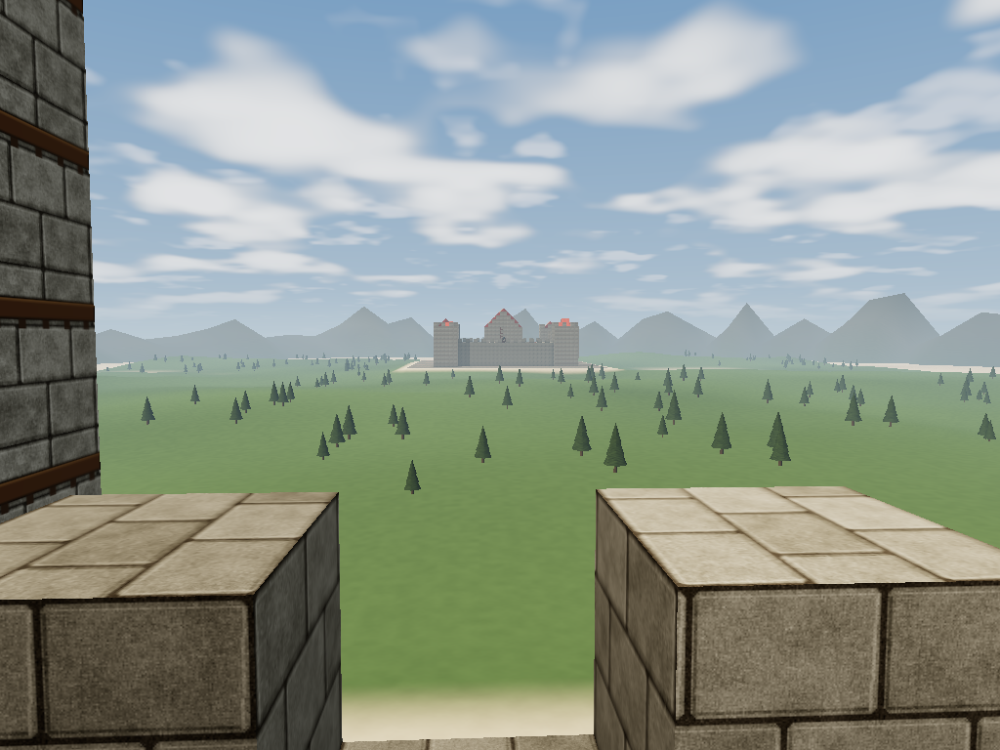
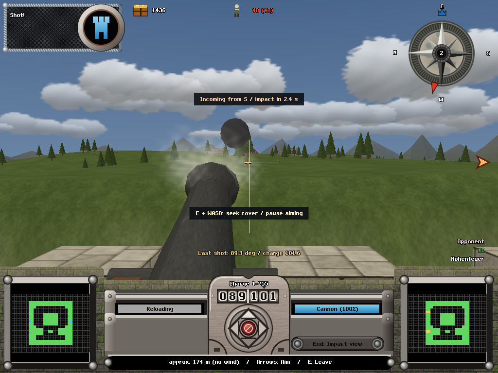
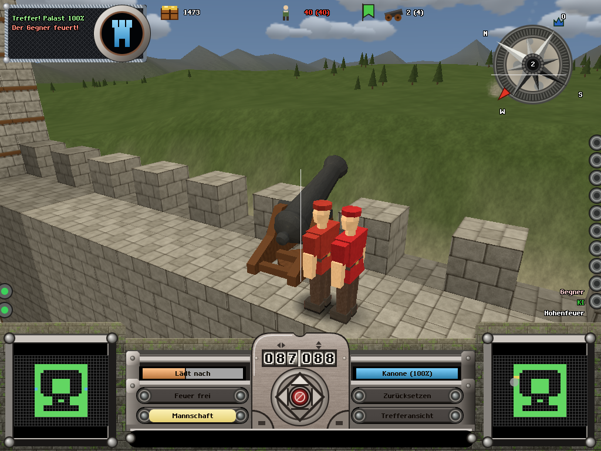
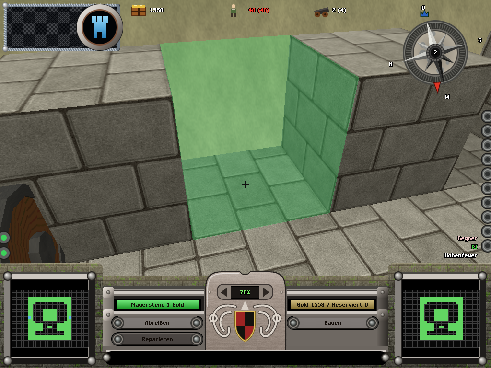
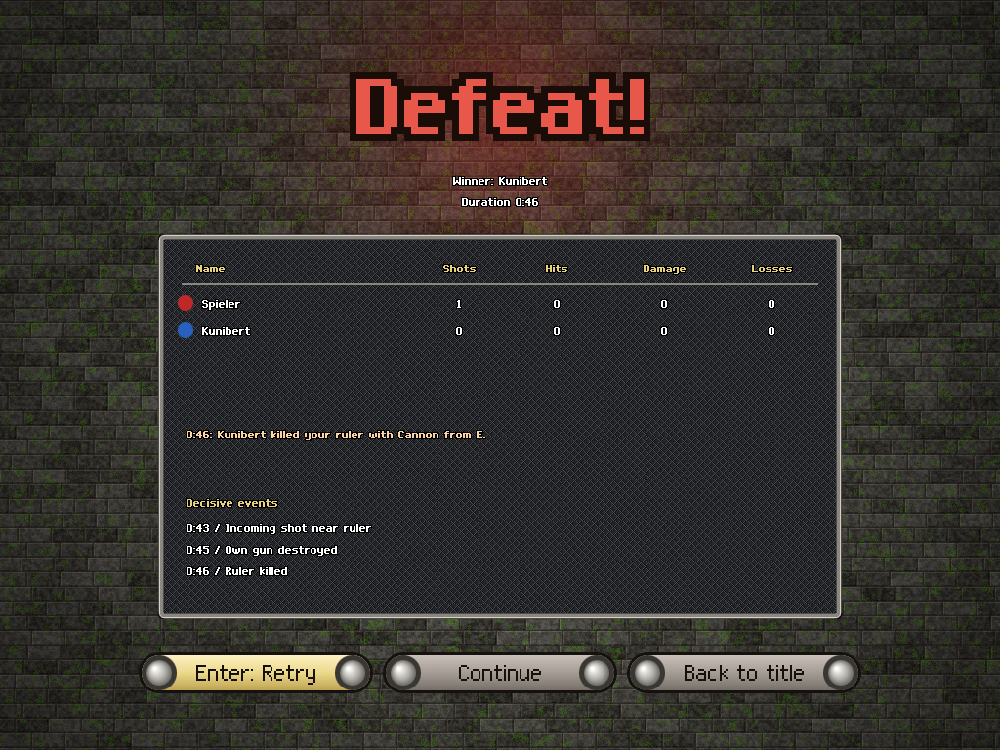

# Hohenfeuer

A real-time, first-person castle artillery duel in the browser, re-imagining *Ballerburg: Castle
Siege* (Ascaron, 2001). You are the ruler of a block-built castle. You walk your own ramparts, man a
cannon with its crew, aim with the original's direction and charge dials, and fire at the enemy
keep while an AI ruler fires back. Masons build what you designate, runners haul powder, civilians
are both your income and your hit points, and one morale number per castle decides whether your
people keep working. One shot through the enemy palace ends the game; one through you does too.

three.js 0.186, plain JavaScript modules, Vite. No framework, no build-time magic, and a simulation
that never touches the renderer so every match can be replayed headlessly from a seed.

| Title screen | Modern preset, rampart view | Incoming shot warning |
|---|---|---|
|  |  |  |
| Crew at the cannon | Designating a wall | Defeat with the cause named |
|  |  |  |

Every image above is a tracked golden screenshot: `npm run goldens` re-renders all 48 of them
with software WebGL and fails if a pixel moves.

## Status (18 October 2026)

Version 0.4. Playable against the AI from the title screen; no multiplayer, no campaign.

**What works**
- Walk the castle in first person among crews, runners, masons and civilians; man any gun; aim with
  the original's dials (direction in tenths of a degree, charge 1-255) and its ballistics: fixed
  elevation per weapon, charge-driven speed, gravity, drag, scatter, splash and a wind that turns.
- The original's weapons as twelve plugins, ten playable (cannon, double cannon, catapult, fire
  catapult, trebuchet, ballista, arcaballista, bomb, rocket, Fat Freda) and two map-only (hellfire,
  zeppelin), each with its own mesh and AI aim profile.
- Designation building: pick stone, tower, mount or a weapon, outline it on the wall, masons pay
  for it and build it under fire. Repairs cost materials and take 12 s per block.
- NPC roles and morale: gun crews are required to fire, runners keep magazines stocked, masons
  repair, civilians pay income and die to splash. Morale falls with palace damage and deaths,
  rallies, and can end the match by surrender.
- The original's 145 castle layouts converted to block castles, four biomes (forest, desert, ice,
  volcano), skirmish setup, quick start, end screen with the decisive events, German and English.
- Two render presets (classic, matched against captures of the 2001 game; modern, with shader
  terrain, sky, fire and water), first-person feel (recoil, shake, head bob, impact follow camera),
  positional audio.
- Onboarding ramp: match 1 shows only the cannon and stone; repair, weapons, crew orders and the
  full arsenal arrive over the first ten matches; prompts retire once you have used them.
- Readability: directional incoming-shot warning with time to impact, two contextual choices
  during every reload, idle guns explain why they cannot fire, the palace bar shows the rising
  defeat line, every shot gets a short/long and left/right readout.

**Measured gameplay** (headless AI-vs-AI sweeps, `scripts/sweep.mjs`, research/20)

| Metric | Value |
|---|---|
| Match length, 150 AI matches across levels 3/5/8 | 82% in 12-20 min, 0 timeouts |
| First shot on every map, both sides | within 21 s |
| Endings, 40 paired level-5 forest duels | 26 palace, 10 ruler, 4 surrender |
| Slot fairness (same seed, swapped sides) | 20/20 |
| Gold sitting at the cap | 0% of match time |
| Novice policy win rate vs AI 2 / 5 / 8 | 7/10, 7/10, 5/10 |

Gameplay is developed as a critic-repair loop against a 22-criterion rubric distilled from game
design literature (research/15). Scores so far: 52/110 (research/16), 60/110 (research/19); a
third critique is in progress. Each critique files its ranked repairs as issues.

**Known rough edges**
- Physical west/east asymmetry: the east castle wins 28 of 40 paired forest duels (slot swaps are
  fair, the terrain is not yet).
- A losing palace can sit nearly unchanged for three minutes in 34 of 40 matches.
- Morale-driven surrender exists in the rules but matches still end by population loss first.
- 80 NPCs cost 88-118 ms per frame on software WebGL; GPU path untested on weak integrated chips.
- No human playtest yet. Every number above comes from scripted policies, not people.
- Period-accurate render preset (DX7-era dither and mip bias) is designed but not built.

## Play

    git clone https://github.com/tobiasosborne/hohenfeuer.git && cd hohenfeuer
    npm ci
    npm run dev          # open the printed URL, press Quick start

Node 24.11.1 (`.node-version`). Everything else, including every git-ignored path and how to
recreate it on a new machine, is in `docs/SETUP.md`.

**Controls**

| Keys | Action |
|---|---|
| WASD or arrows, mouse | walk and look; Space jumps |
| E | man or leave the gun you are looking at; interact |
| Arrows / numpad 8 2 4 6 while manning | aim: range (charge) and direction |
| Space or numpad 0 | fire |
| F | auto-fire at the current aim |
| Home / End | restore last aim / hold to watch the impact |
| PageUp / PageDown | previous / next weapon |
| Q | order crew to the gun you are looking at |
| R | mark a damaged block as repair priority |
| B / G, then digits 1-9 | designate blocks / weapons, pick the type |
| X | send civilians to shelter |
| Tab | hold to see job markers |
| Esc | menu |

Developer URL parameters: `?play=1` skips the menu, `seed=`, `speed=`, `lang=de|en`,
`style=classic|modern`, `profile=` (onboarding match number), `demo=tb1|tb2|tb3|feel`,
`golden=1` (fixed-pose capture mode). See `src/main.js`.

## How it is built

```
src/contracts.js   commands, events, block ids, roles, plugin registries (the only integration point)
src/tuning.js      every game number, deep-frozen, with its source noted
src/core, world    fixed-step loop, RNG streams, block world and collapse
src/sim            ballistics, damage, weapons, economy, wind, rules (pure, deterministic, 30 Hz)
src/npc            jobs, pathing, crews, morale, brains
src/ai             AI rulers: public view, targets, aim learning, build plans, slots
src/plugins        blocks, weapons, castles (145 generated), maps, biomes
src/render         three.js scene, block mesher, people, styles, shaders, fx
src/player, ui     first-person controller, HUD drawn from the original's layout, menus, i18n
src/audio          synthesized sfx
tests/unit         node --test, 77 files; tests/goldens 48 fixed-pose screenshots; tests/evidence logs
scripts/sweep.mjs  headless N-match AI sweeps; scripts/novice.mjs scripted human proxy
tools/blender      Blender 4.5 scripts that generate assets/kit-v1 (blocks, weapons, people)
```

- The simulation is pure: no three.js, DOM, clock or randomness inside it; a test enforces this.
  Two runs with the same seed and command stream produce the same state hash, which is what the
  goldens, the sweeps and the future netcode rely on.
- Weapons, NPC types, blocks, castles, maps and biomes register through `src/contracts.js` only.
  Adding a weapon is a folder under `src/plugins/weapons/` with a sim definition and a view.
- `docs/DESIGN.md` is the binding design (world, sim, NPCs, player, AI, rendering, plugins, module
  ownership, engineering rules, phase plan). When code and design disagree, one of them is fixed.

## How the work is organised

Development is orchestrated by Claude Code with parallel agents (Claude and OpenAI Codex) working
in disjoint file lanes, in tracer-bullet slices: each slice lands end to end with a headless test
and a golden screenshot before the next starts. Briefs and reports live in `codex-logs/`, the
day-by-day record in `docs/worklog/`, the current state and next step in `HANDOFF.md`.

Issues are tracked with [beads](https://github.com/steveyegge/beads); the snapshot is
`.beads/issues.jsonl` (`npm run beads:import` after cloning, `bd ready` for open work).

## Contributing

1. Read `CLAUDE.md` (the laws, two minutes), then `docs/DESIGN.md`, then `HANDOFF.md`.
2. Pick an issue (`bd ready`) or open one. Repairs that move a rubric criterion in research/19
   are the current priority.
3. Red-green: a failing test first, then the change. `npm test`, `npm run test:browser` and
   `npm run goldens` must pass; a golden that legitimately changes is replaced after you have
   looked at the diff in `test-results/`.
4. Keep the sim pure, register plugins through contracts, put numbers in `src/tuning.js`, open
   every file with a one-line "owns" comment, pin exact dependency versions.
5. Clean room: never copy code from the GPL Ballerburg SDL port or any other project, and never
   commit anything ripped from the original game. Reference material stays in git-ignored folders.
6. Commit style `area: summary` in lowercase. The gameplay numbers you cite must be reproducible
   from a script in the repo.

## Roadmap

- Phase 0 scaffold, Phase 1 playable duel, Phase 2 NPCs and morale: done.
- Phase 3 (current): full weapon set, designation building, look polish, and the critic-repair
  loop toward 70/110 on the rubric. Next: terrain symmetry, palace plateaus, morale surrender,
  the first human playtest, period render preset.
- Phase 4: human slots and performance (billboarded NPCs beyond 40 m, GPU path profiling).
- Out of scope by decision: the campaign and world map, multiplayer netcode, spells beyond the
  weapon set, anything but the artillery duel (research/00).

## Research and the original game

`research/` holds the scoping decisions, the ground truth about the 2001 game, the reverse-engineered
container formats of its CD (`scripts/rip/`, clean-room format tools, no CD code is ever executed),
the manual's mechanics, the static analysis of the executable's ballistics, two look-and-feel passes
against captures of the original, the design-principles rubric, and every critique and repair
report. The original game's assets, screenshots, manual text and UI sheets are used only as local
references (`assets-ripped/`, git-ignored) and are never redistributed; everything shipped in
`assets/` and `src/` is re-authored. Ballerburg is a trademark of its owners; this is an
independent fan re-imagining.

## License

MIT (`LICENSE`). Code, re-authored assets in `assets/` and the documentation are all under it; use
it, fork it, sell it. The only things not covered are the things not in the repo: the original
game's assets and manual, which stay as local references and are never distributed here.
