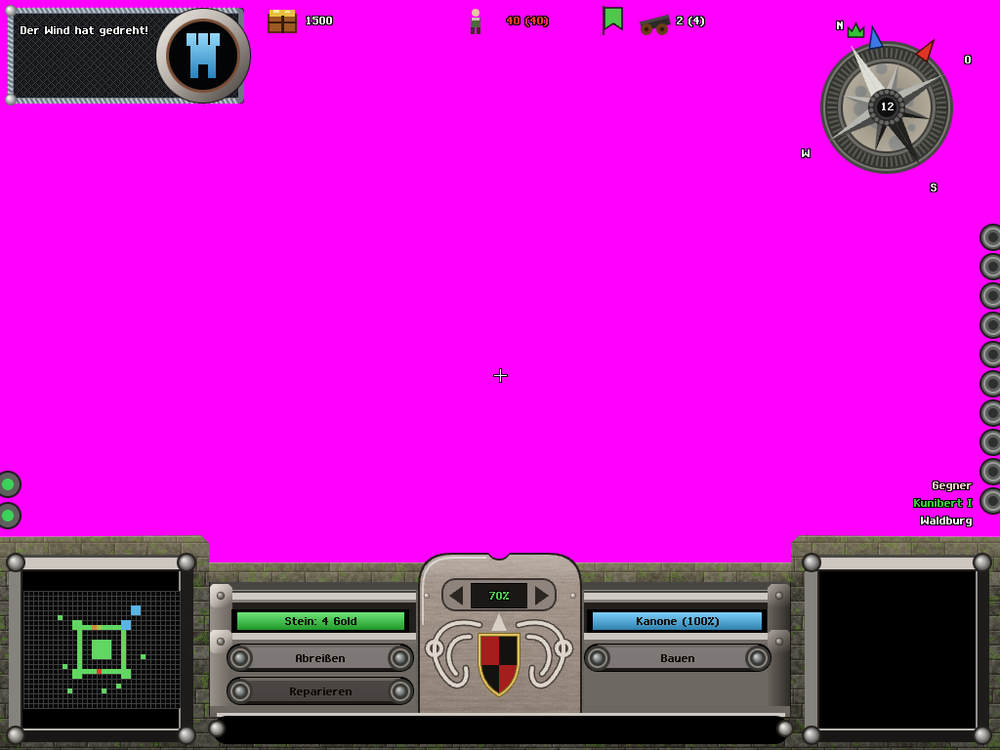
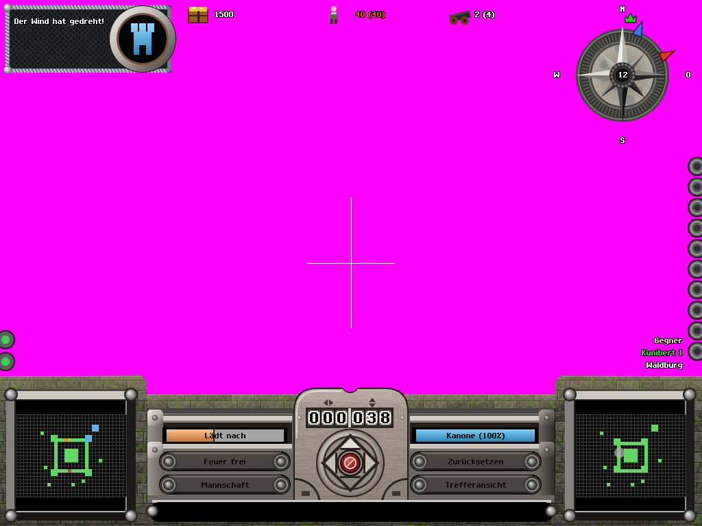
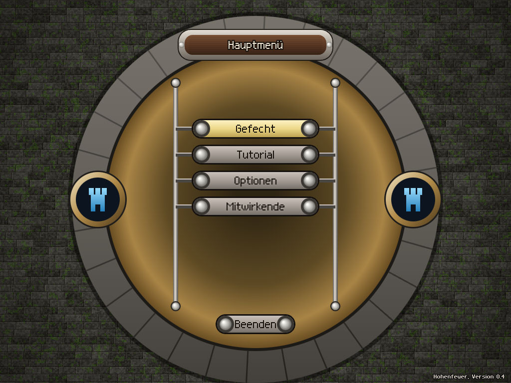

# 18 — Repair 5: onboarding and the complexity ramp

2026-10-18. Implements research/16 repair 5 and section 5, against Tobias's
“easy pick-up-and-play, not too encyclopaedic and daunting” target from research/00 round 4.
Issue: `castle-game-uo7.7`. Browser/visual acceptance remains open under `castle-game-me0`.
No simulation, NPC, AI, tuning, render or plugin files were edited. No git commands were run.

## The player contract

`src/progression.js` owns a versioned `hohenfeuer.profile.v1` localStorage record:
completed matches, successful paid shots, cannon shots, direct hits, wins, concepts unlocked,
and three prompt-use counters. Counters update from successful simulation results, not attempted
keypresses. Salvos count once, matching the end-screen shot statistic. Abandoned/restarted matches
retain shots/hits/prompt learning but do not advance the completed-match count. Finishing twice is
idempotent. The current battle pins its starting tier, so a victory does not reveal next match's
controls under the end screen. Missing, malformed or denied storage falls back to an in-memory profile.

`visibleFeatures(profile)` is a pure query returning HUD flags, key codes, block ids and weapon ids.
The same result gates keyboard, mouse hit regions, palette selection, reticle interaction and generated
commands. Input cannot obtain a locked weapon by looking at one in a custom map. Simulation rules and
AI loadouts stay the same. Existing scripts retain their command streams; goldens/demos use isolated
veteran fixtures unless explicitly overridden. Golden style selection ignores saved user options.

“Schnellstart” is the focused first title action. One click/Enter starts forest-duel, seed 1,
local slot 0 versus AI level 2, with the newcomer surface. It retains real career counters; choosing
full “Gefecht” uses the career ramp. Full setup is one click from the title, with its existing settings.
Quick start intentionally keeps the introductory control set on repeat practice matches.

## Ramp table

Match number is completed matches + 1. Every row retains earlier controls and content.
There is one scheduled lesson per match. The tenth-cannon-shot discovery is an optional second
moment, as allowed by this repair request; it adds no new binding before placement is taught.
Toasts queue sequentially for six simulation seconds each and repeat no concept already recorded.

| Match | New concept / content | New keys / selection | HUD elements exposed |
|---|---|---|---|
| 1 | Walk; man one cannon and auto-order its crew; aim/fire; inspect impact; designate stone walls | WASD/arrows, E, aim arrows or readout drag, Space, End, B; mouse click confirms, right click cancels a plan | Gold, population, wind compass, own minimap, labelled income. Weapon view adds charge, reload/condition, fire, impact control and enemy minimap. Three retiring reticle prompts. |
| 2 | Repair triage with morale feedback | R repair/ammo priority | Repair button; named, coloured morale pennant with labelled percentage; reasons on band changes |
| 3 | Weapon placement and selection; cannon + qualified catapult; tower/mount construction | G; wheel, digits, PgUp/PgDn in the placement palette; Home restores aim | Placement button, weapon count/cap, selection name/cost, restore button; two weapon choices after cannon practice |
| 4 | Delegate shooting | F auto-fire | Auto-fire button; walking enemy minimap (after match 3) |
| 5 | Manage people and orders | Q crew, X shelter, hold Tab for job markers | Crew button, shelter state, order hints, job overlay. Flee/shelter exception icons remain readable without holding Tab. |
| 6 | Broaden the arsenal with familiar controls: double cannon, ballista; wood/floor | Existing B/G palette controls | Two more weapon choices and two materials |
| 7 | Incendiary equipment: fire catapult; roof | Existing B/G controls | One weapon and one material |
| 8 | Heavy lobbed equipment: trebuchet; stairs/ladder | Existing B/G controls | One weapon and two access pieces |
| 9 | Rocket/arcaballista; door | Existing B/G controls | Two weapons and one access piece |
| 10 | Heavy salvos: Fat Freda/Hellfire; magazine | Existing B/G controls | All ten playable weapons and all ten non-map-only construction types |

Catapult qualification occurs at ten successful cannon shots, across matches. Other weapons' shots
and hits do not count. Its discovery gets a console line and a short toast; G remains hidden until
match 3. Match 10 grants the full roster even to a player who completed matches without ten cannon
shots, preventing a permanent content lock. The unavailable zeppelin/bomb stubs never enter the
palette: the UI reads registered definitions and the existing availability hook. Weapon selection
cycles palette entries; it does not create remote manning or change the simulation's distance rule.

The critique's proposed schedules conflict in places (R appears in both match 1 and later rows;
Q is simultaneously a first-time prompt and an auto-crew replacement). This implementation follows
the repair request: R at 2, placement at 3, shelter/orders at 5. Auto-fire gets the spare match-4
lesson. Materials arrive gradually instead of adding seven choices in the final match. Later weapon
variants reuse the same B/G controls. There is no modal, tutorial level, research tree or new sim gate.

## The three prompts

| Prompt | Context | Successful use counted |
|---|---|---|
| `E: Kanone bemannen` | Own cannon under the reticle, within 3 m, walking | Simulation actually changes the ruler's manned weapon |
| `Leertaste: Feuer` | Manned/loaded gun, affordable shot and sufficient ammunition | A manual fire command actually increases paid shots |
| `B: Bauen` | First damage/destruction of an own stone/tower/mount wall; walking outside build mode | Entering stone build mode after that damage |

One prompt is selected at a time: cannon interaction takes precedence over building; fire appears
only in the weapon context. Each retires after two successful uses, persisted per profile. Repeats,
failed fire, failed manning and leaving a build mode do not count. English equivalents are provided.
E always orders crew automatically; a beginner never needs to discover Q to reload properly.

## HUD hygiene and units

The twelve decorative side buttons and their misleading menu hit region are removed. Locked console
buttons have neither labels, capsule art nor mouse actions. Match 1 also hides the unusable weapon-cap
counter and Home restore control. The enemy minimap, frame and label disappear while walking through
match 3; its screen area becomes transparent. Weapon/impact view retains it as an aiming instrument.

The old unlabelled 70% centre widget becomes `Einkommen +N.N Gold/s`, calculated from the same palace
and working-civilian rates as the economy. Taxes remain out of scope. Morale moves to its named
pennant from match 2. Band-change messages attribute recent loss, incoming damage or own hits;
this is a coarse event explanation rather than a numerical morale-formula breakdown.

The aiming console says `Ladung 1-255`; both the displayed value and playable input clamp to those
bounds. Its permanent secondary line gives approximate metres at the gun's landing height, without
wind/scatter, using the existing production trajectory tracer (including rocket propulsion).
It says `ca. … m (windstill)`: charge is not a five-metres-per-unit ruler. Aim and leave hints stay
in the console; advanced order keys only appear when unlocked. Messages wrap to the actual bitmap
font width and at most four text rows, avoiding the badge and other HUD areas.

## Before and after evidence

The existing baseline HUD PNGs were copied before this session's UI edits, then visually inspected:

**After screenshots are pending, not fabricated.** This runner denies Vite's localhost listen with
`EPERM`; even offline Chromium exits on a restricted crashpad socket operation. Consequently no
SwiftShader after capture or golden PNG replacement has been performed in this session.
`tests/evidence/onboarding/capture.mjs` writes `after-match1.png`, `after-match3.png`, `after-walking.png`,
`after-weapon.png` and `after-title.png` after two exactly identical captures per pose, a SwiftShader
renderer assertion and an unchanged-source SHA check. `tests/ui-onboarding.mjs` also captures the
actual first-wall-damage prompt. Add those images here after visual review on a socket-enabled runner.

New deterministic poses: `hud-match1`, `hud-match3`, `quick-start-title`. URL fixtures are
`?golden=1&profile=0`, `profile=3`, `profile=10`; 0 means newcomer, 3/10 mean that current match's
already-seen tier. The debug API exposes `profile`, `features`, `onboarding`, `setProfile(0|3|10|object)`
and `setPose({profile: …})`. Overrides do not read/write a real profile and never alter sim state/hash.
Existing `npc-markers` now explicitly requests `showJobs: true`.

Actual re-captured existing goldens: **none**, because captures were blocked. Legitimate HUD
replacement candidates, to inspect individually: `hud-weapon-view`, `hud-walking`, `menu-title`,
`tb1-spawn`, `tb1-first-shot`, `example-wall`, `courtyard-palace`, `crew-at-cannon`, `cannon-sight`,
`muzzle-flash`, `smoke-trail`, `impact-dust`, `tb3-designate`, `tb3-built`, `match-over`, `feel-recoil`,
`impact-view`, `npc-markers`. `menu-skirmish` should remain unchanged. Render-only poses are outside
this capture's replacement scope. All four `modern-*` poses are explicitly ignored by the helper
while the concurrent render lane changes them; the normal npm golden command was blocked before
it could compare any pose. No baseline has been silently accepted.

## Rubric 9–12 and 16

These are provisional code/test assessments, not human-play or completed visual acceptance scores.
The required three-stranger first-hit/finish study has not been run.

| Criterion | Critique v1 | Provisional now | Evidence and remaining limit |
|---|---:|---:|---|
| 9 First-match onboarding | 2 | 3 | Quick start at AI 2, E auto-crew, three retiring prompts and stone only. Browser path is scripted but blocked here; first hit under four minutes is not measured. |
| 10 Signalling over text | 3 | 4 | One contextual reticle prompt, small non-modal toasts, working build ghost/cost labels; no manual needed for the initial bindings. Visual/stranger confirmation remains. |
| 11 Rule consistency | 3 | 3 | Honest charge units/bounds, production-trace metre estimate, labelled income and identical AI/sim rules. Morale reasons remain coarse; fear/logistics still need fuller cause signalling. |
| 12 Complexity ramp | 2 | 4 | Pure, tested tier gates; one scheduled lesson and at most the optional shot milestone; no late material dump. Bundled content variants and lack of human observations preclude a 5. |
| 16 HUD/alert hygiene | 3 | 4 | Dead controls removed, one early walking minimap, hidden order bindings, labelled income, bounded messages and one reticle prompt. After-image verification remains pending. |

## Validation and handoff

Red-first logs, the current UI suite, build output, profile inventory, browser failures and capture
report are in `tests/evidence/onboarding/`. `feature-inventory.json` gives the exact ten-tier keys,
weapons, materials and HUD flags. The current UI suite passes 113 tests with zero skips/failures;
production build passes. Full `npm test` passes all 68 files, zero failures/skips, in 513.827 s
(`npm-test-final.txt`). A real headless sim/reticle/input check reaches and mans the cannon,
auto-orders its crew and fires one paid shot at tick 254; two runs produce identical JSON and hash
(`headless.json`, `headless.txt`, `headless-repeat.txt`). This is scripted evidence, not a stranger test.
The first full run caught the unsupported middle-dot glyph; it was replaced and font coverage passes.
Browser smoke, ui-flow, onboarding acceptance and goldens are **unverified**, all blocked at the
runner boundary rather than skipped or weakened. `castle-game-me0` owns that remaining acceptance.

On a socket-enabled runner: run `npm run test:browser`, `node tests/ui-flow.mjs`,
`node tests/ui-onboarding.mjs`, then `node tests/evidence/onboarding/capture.mjs`.
Inspect the actuals and use the helper's explicit `--accept=name1,name2` list for legitimate HUD
changes and the three new poses; it never accepts modern or render-only names. Run `npm run goldens`
after acceptance, with concurrent modern changes coordinated separately. Update this report's after
images and measured results, then close the acceptance issue and parent repair.
