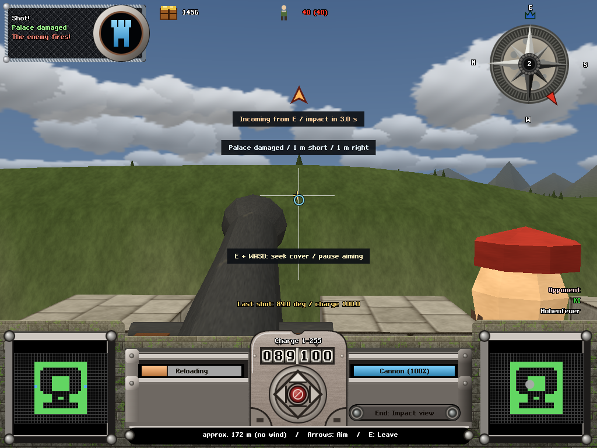
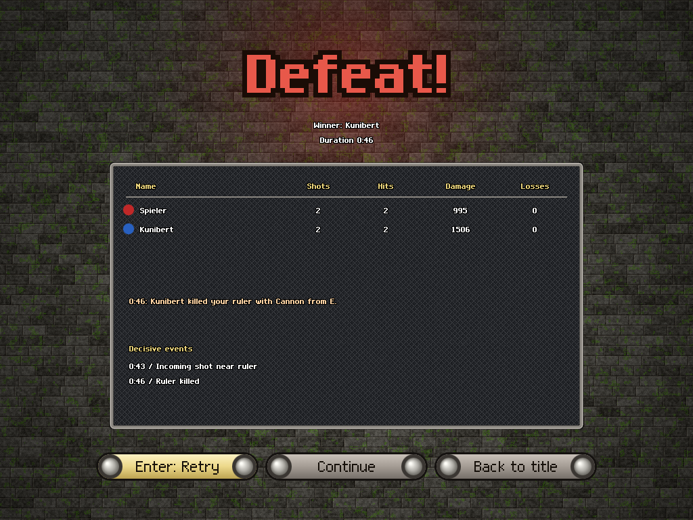
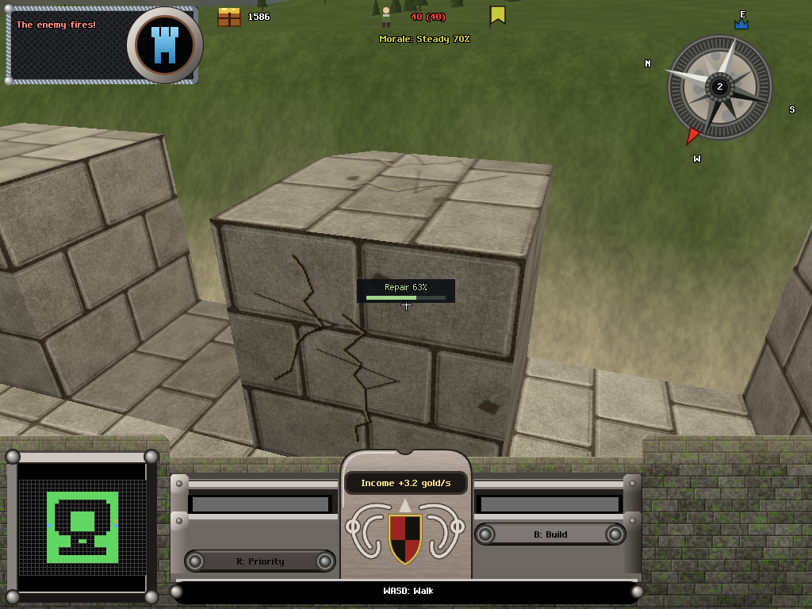
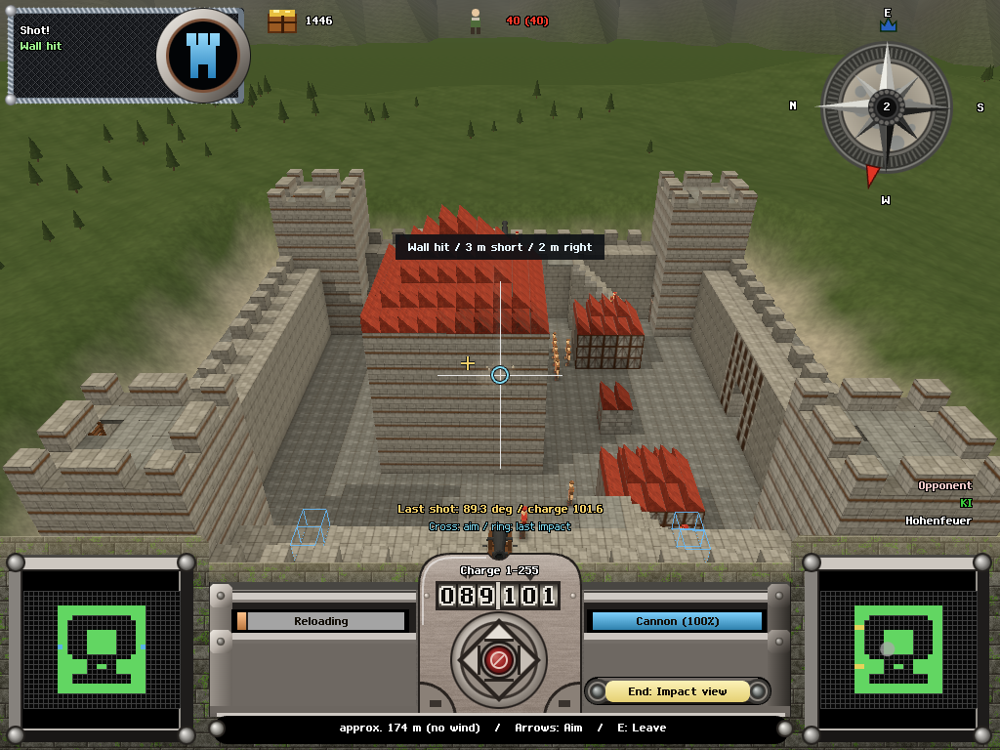

<!-- owns: repair-wave-2 UI implementation, visual evidence, measured limits and provisional rubric scores. -->
# 21 — Repair wave 2, UI lane

2026-10-18. Brief: research/19 sections 3–5 and 7, with the research/18 complexity ramp preserved. No git commands or `bd dolt push` were run. Simulation, NPC, AI, tuning, map plugins and contracts were not edited by this lane.

The implemented surface remains contextual. World progress labels reserve the palace/pressure area, avoid each other, and yield to incoming/impact messages; AI watch mode does not advertise player actions. Match 1 retains the cannon and stone controls. R, G and Q still arrive in matches 2, 3 and 5. There is no additional binding, permanent panel, resource reward, automatic intervention or simulated-state stub. Golden fixtures override the HUD view only, behind `golden=1`.

## What changed

**Incoming danger and attributable failure.** `EV.RULER_THREAT` creates a directional screen-edge arrow, an ETA and a 0.4-second two-tone warning, limited to one per second even during a salvo. Projectile IDs deduplicate warnings; impact or ETA expiry removes them. The bearing follows the camera and originates at the firing weapon, with a castle-origin fallback. The match-1 safety choice uses E and WASD and states the cost: pausing aim. The end screen uses the recorded ruler-death source, weapon, bearing and battle time; palace losses show integrity against the actual line; surrender names harmful pressure or the population trigger. Missing old-event attribution is described without inventing a shooter. Up to three decisive events are retained, with repeated voxel/casualty events coalesced. The actual elimination reason takes precedence when palace breach and ruler death happen together; falls, fire, projectiles and collapsing masonry have honest fallback causes. Enter defaults to retry and preserves setup. Local elimination also opens this screen in a battle where other castles remain alive.

**Reload choices and repair.** `src/player/interventions.js` finds at most two useful actions using the real picker, range, feature gates, gold, job priority and `canDesignate`/ghost rules. It offers an affordable visible repair, an unordered visible gun, a replacement at a legal destroyed-gun site, a missing/reinforcing stone block, or movement under threat. It explains when the player must leave the cannon and look at the marked site before issuing an order. The renderer also checks weapon-mesh occlusion so a barrel cannot conceal a suggested repair. Existing priority jobs, full-health blocks, unaffordable orders and occluded sites disappear. Nothing rewards repeated keys. Active repair/build jobs show progress on the block and disappear after completion. The first-damage cue retires after a successful local intervention; the existing profile prompt counters are retained.

**Idle-gun diagnosis.** The reticle reads `idleReason` plus `detail`/`idleDetail`: missing crew with present/required counts, ammunition and a hauler already en route, gold, obstruction, damage or reload. Actions respect current feature gates and interaction distances. Missing fields hide the diagnostic. A manned gun's ordinary reload remains in the existing reload bar, without a redundant wait caption.

**Palace and surrender.** The palace bar appears after damage or immediately before minute 10. Its pale marker and red segment use `palaceDefeatThreshold`; percentages retain one decimal where necessary. Six-second notices occur once at the start of the ramp and once at 55%. Missing integrity/threshold hides the bar. Morale receives one contextual line: actual signed pressure causes and the surrender hold clock or population condition. Ordinary full-morale quiet recovery adds no permanent text. Missing `surrender`/`pressure` hides the line.

**Impact as an instrument.** Every own shot captures its fired aim, origin and calm-air aim point. The impact is resolved into short/long and left/right metres in that shot's coordinate frame, independent of subsequent aim changes. The message lasts 60 ticks (two seconds), distinguishes wall impact from actual palace damage, and preserves the previous shot settings and reference marks. The amber cross marks the aim; the blue ring marks the last impact. Wall interception is identified explicitly, so a short wall hit is not presented as proof that more charge is needed. The existing impact camera and bindings remain. Gameplay now supplies authored `Sight` world positions to the camera rig; full per-weapon sight calibration remains in `castle-game-hoq`.

## Evidence and verification

All screenshots are 1024×768, device scale 1, Chromium through `tests/lib.mjs`, with the SwiftShader renderer asserted. Evidence lives in `tests/evidence/repair-wave-2-ui/`.

| Subject | Before | After | Kind |
|---|---|---|---|
| Ruler warning | `before-danger.png` | `actual-danger.png` | Actual AI5 seed-6 novice command replay |
| Decisive loss | `before-loss.png` | `actual-loss.png` | Actual ruler death, source and retry |
| Impact | `before-impact.png` | `actual-impact.png` | Actual TB1 shot and two-second expiry check |
| Repair | Old gun-facing views in research/19 | `actual-repair-before.png`, `actual-repair-progress.png`, `actual-repair-after.png` | Actual R input, paid masonry and visible progress |
| Palace line | `before-palace.png` | `actual-palace-0959.png`, `actual-palace-1001.png`, `actual-palace-1230.png`, `actual-palace-1501.png` | Real clock timeline; report in `palace-timeline.json` |
| Reload alternatives | Existing reload bar | `reload-choices.png`, `reload-replacement.png`, `first-damage-match1.png` | Explicit HUD fixtures / goldens |
| Idle guns | Cannon condition alone | `idle-no-crew.png`, `idle-no-ammo.png`, `idle-no-gold.png`, `idle-obstructed.png`, `idle-damaged.png` | Explicit reason fixtures / goldens |
| Surrender | Morale band alone | `surrender-pressure.png`, `defeat-surrender.png` | Explicit contract fixtures / goldens |

`ui-repair-cohort.mjs` also verifies a causal fallback sentence in both languages for all 11 losses in the prior 30-match cohort; it does not claim a new 30-match rerun. The original seed-6 replay still loses its ruler at 0:46. A launch warning at 0:43 gives about three seconds of lead time. The account identifies Kunibert, Cannon and east. `tests/ui-repair-replay.mjs` checks browser/headless agreement, Enter retry preserving seed 6, and local defeat before a multi-castle battle has a global winner. The live sim changed during a later run, producing a hash mismatch; that was not accepted as a replay pass. Final reproducible captures use the temporary source snapshot recorded, file by file, in `frozen-source.json`. The final snapshot hashes are in `frozen-source-final.json`. Final shared-tree differences are recorded in `shared-tree-differences.json`; these snapshots are UI acceptance evidence, not a claim that concurrently edited simulation code is frozen.

`tests/ui-repair-actions.mjs` uses a normal first-person reticle and R. A stone block starts at 24/40 HP. Its prompt quotes 1.3 gold, conservatively rounded from 1.28 gold of materials. A mason travels to it, visible health reaches 25/40 (63%), and the repair completes at 40/40. Income continues during this interval, so the treasury rises despite paying for the repair. `actions.json` records ticks, health, job progress, input target and costs. The prompt retires after the order and progress disappears when finished. The same script checks a real impact, disappearance of the offset at two seconds and persistence of the reference.

Red/green evidence: `red-feedback.log`, `green-feedback.log`, `red-interventions.log`, `green-interventions.log`. Tests cover local warning filtering and expiry, missing fields, notice deduplication, signed miss axes, immutable shot references, cause fallback, signed pressure, one-action retry, affordability, redundant priorities, occlusion, range, match-1 gates and legal first-damage reinforcement. The final lane suite passes all **157 tests** and is recorded in `lane-tests.log`; production build in `build.log`; smoke and flow in `browser-final.log` and `ui-flow-final.log`. The shared-tree `ui-onboarding.mjs` also passes all six checks, including E auto-crew/fire, successful prompt-use counts, legal first-damage stone guidance, locked keys, and profile 0/3/10 (`onboarding.log`).

The initial shared-tree full `npm test` ran 477 tests: 473 passed and four failed outside this lane (AI level-1 accuracy, AI retargeting, the old 15-minute AI-match limit, and one-cell NPC step-down). Details were passed to the sim lane through the shared Bead. The snapshot-wide run (`unit-all-frozen.log`) reported 429 tests: 420 pass, 8 fail, 1 skip. Five failures came from two omitted snapshot fixtures; copying those fixtures and rerunning the affected tests passed all 58 checks (`snapshot-fixtures-retest.log`, `snapshot-manifest-retest.log`). Three simulation-wide failures remain in that snapshot: the old 15-minute match cap, the leadership-route climb/manning scenario, and an outdated tuning expectation. No global-green claim is made. All 157 final UI/player/render tests pass on the shared tree.

The sim lane subsequently changed the ramp to quadratic and then changed its base from the brief's 30% to 20%. Final actual-clock captures display the published values: 20%, 20.00036%, 28.74611% and 55% at the four requested times (the state snapshot follows the evaluated tick). The 12:30 bar reads 28.7%. This difference from the brief is recorded on `.14` for the sim/orchestrator; the UI does not disguise it by hardcoding 30%. Earlier 30→55% linear-ramp contract goldens remain arbitrary-field fixtures, distinct from the current-clock captures.

## Measurements and limits

The unchanged `scripts/novice.mjs` still runs. `tests/ui-repair-proxy.mjs` measured seed 1 against AI2/5/8: 33/31/34 eligible reloads; 2.91/3.71/3.68 locally available types; 0.70/0.94/0.97 distinct non-aim types actually exercised. The policy does not observe the HUD and is not a human study. Its preference for repair is unchanged, and simulation changes confound before/after outcome comparisons. These numbers establish available choices, not improved discovery or decision density caused by this UI.

The calm-wind probe uses ten seeds, a rough charge of 96, an initial bearing error of two degrees, observed lateral correction and two-charge bracketing. The policy does not call an aim solver. All ten hit the enemy castle within four shots (in fact on the first shot), but none reaches within three metres of the keep centroid because masonry intercepts the shots. The actual gun-to-centroid distance is 175.5 m on the nominal 190 m castle-spacing map. **This does not demonstrate the requested precise 190 m convergence.** `aim-probe.json` preserves all 40 shots and signed offsets. This acceptance remains open in `castle-game-uo7.15`; a successful castle hit is not substituted for learning to converge on a chosen point.

The stricter palace-stall check was re-read from the sim lane's `sweep-endings-probe4.json`: after 120 seconds, longest elapsed span with a palace range below two percentage points. Seven of ten losing castles still have a span over three minutes; maximum 415 seconds. `stall-check.json` records source hashes and the per-seed data. This was an ongoing sim candidate, not a new independent final sweep. The UI exposes the line; it does not fix the measured low-motion spans.

No unbriefed human sessions or listening/comprehension study were performed. The three-person discovery/workload acceptance in `.10` and `.13` remains open. Pressure and hold-clock rendering is the UI half of `.11`; the sim lane owns ending variety, pacing and morale guard validation. `hoq` remains open for non-cannon sight calibration. `.9` and `.14` are closed with evidence; `.10`, `.13`, `.15` remain open for the stated acceptance gaps, and `.17` tracks final shared-tree integration.

## Golden changes

Twenty new poses cover danger in match 1, two reload alternatives, replacement, first-damage stone, block repair progress, five idle reasons, four palace times, surrender pressure, two impact types and three defeat causes. They use the existing `page`/`setPose` mechanism. Fixtures are deliberately labelled as fixtures above; they are not claimed as naturally occurring battle states.

Eleven existing baselines legitimately change: `tb1-first-shot`, `crew-at-cannon`, `muzzle-flash`, `smoke-trail`, `impact-dust`, `tb3-built`, `match-over`, `modern-impact-dust`, `feel-recoil`, `impact-view`, `npc-markers`. Their actual PNGs were inspected before replacement. The changes are shot settings/reference marks, impact classifications/offsets, local work progress, and retry/end-screen layout. Original PNGs are retained in `golden-before/`. `golden-changes.json` lists the exact names. **Final result: all 48 poses have a zero-pixel comparison** against the recorded snapshot after inspected layout and fixture refinements. `goldens-final.json` maps each pose to its final verification log. Twenty poses are new; eleven prior baselines were replaced. The current sim-side differences still require `.17` integration; no live-tree golden claim is substituted for this snapshot result.

## Provisional scores — requested subset only

Scores are conditional UI-lane assessments, not a new independent 110-point critique.

| Criterion | v2 | Provisional | Evidence / limit |
|---|---:|---:|---|
| A1 | 3 | 4 | Real signed offset within two seconds and persistent shot reference; precise 190 m convergence still open. |
| A2 | 3 | 3 | Legal contextual choices visible; unchanged proxy does not establish human uptake. |
| A4 | 2 | 2 | No new chores or bindings; three-role workload still needs the human sessions. |
| C10 | 3 | 3 | World markers and repair progress help; most-verb comprehension is unmeasured. |
| C11 | 3 | 4 | Actual moving defeat line and surrender clock made explicit; prediction study remains unperformed. |
| D13 | 3 | 4 | Actual wall/palace classification plus signed offsets, reference ring and impact camera. |
| D14 | 2 | 4 | Real seed-6 warning before impact, directional cue, short sound recipe and attributed death. |
| D15 | 2 | 4 | Distinct crew/ammo/funds/obstruction reasons, details and gated next steps. |
| D16 | 4 | 4 | One prompt, at most two choices, expiring notices; no beginner control expansion. |
| E18 | 3 | 4 | Actual 24→25→40 HP repair, quoted material cost and in-world progress; rebuild trade-off discovery untested. |
| E19 | 2 | 3 | Actual pressure vocabulary and surrender progress rendered; pacing/spiral guards remain sim evidence. |
| F22 | 2 | 4 | Causal sentence, short event account and one-key retry verified; perceived fairness untested. |

## Strings added

All 84 additions are in `src/ui/i18n.js` in German and English. The exact machine-readable inventory is `tests/evidence/repair-wave-2-ui/strings.json`; the full inventory follows. Existing plugin weapon/castle names remain the source of proper names.

| Key | Deutsch | English |
|---|---|---|
| `incoming` | Beschuss aus {dir} / Einschlag in {s} s | Incoming from {dir} / impact in {s} s |
| `palaceBar` | Palast {pct}% / Niederlage unter {line}% | Palace {pct}% / defeat below {line}% |
| `palaceRising` | Ab Minute 10 steigt die Niederlagelinie bis 55%. | From minute 10 the defeat line rises to 55%. |
| `palaceReached` | Niederlagelinie jetzt 55%. Palast darüber halten. | Defeat line now 55%. Keep the palace above it. |
| `pressureLosses` | Verluste | losses |
| `pressureDamage` | Beschuss | bombardment |
| `pressurePalace` | Palastschäden | palace damage |
| `pressureFire` | Feuer | fire |
| `pressureStrain` | Kampfbelastung | battle strain |
| `pressureGuns` | Geschützverlust | lost guns |
| `pressurePopulation` | Bevölkerungsverlust | population loss |
| `pressureRally` | Eigene Treffer | successful hits |
| `pressureRecovery` | Erholung | recovery |
| `surrenderHold` | {cause} / Aufgabe {s}/{total} s | {cause} / surrender {s}/{total} s |
| `surrenderPopulation` | {cause} / Bevölkerung {pop} < {line}: Aufgabe | {cause} / population {pop} < {line}: surrender |
| `pressureSafe` | {cause} / Aufgabe ab {line}% Moral | {cause} / surrender at {line}% morale |
| `idleCrew` | Mannschaft fehlt | Missing crew |
| `idleAmmo` | Munition fehlt | No ammunition |
| `idleGold` | Gold fehlt | Not enough gold |
| `idleBlocked` | Schussbahn blockiert | Firing lane blocked |
| `idleDamaged` | Geschütz beschädigt | Gun damaged |
| `idleWait` | Nachladen abwarten | Wait for reload |
| `idleMan` | E: bemannen, Crew rufen | E: man gun, call crew |
| `idleCrewComing` | Mannschaft unterwegs | Crew ordered; waiting |
| `idleOrder` | Q: Mannschaft rufen | Q: call crew |
| `idleApproach` | Zum Geschütz gehen | Walk to the gun |
| `idleHauler` | Träger unterwegs | Hauler en route |
| `idleAmmoOrder` | R: Munition zuerst | R: prioritize ammunition |
| `idleSupply` | Magazin prüfen | Check the magazine |
| `idleIncome` | Einkommen abwarten | Wait for income |
| `idleTurn` | Pfeile: freie Bahn suchen | Arrows: aim for a clear lane |
| `idleInspect` | Hindernis vor dem Rohr prüfen | Inspect the block in front of the muzzle |
| `idleOtherGun` | Intaktes Geschütz aufsuchen | Go to an intact gun |
| `impactShort` | {m} m kurz | {m} m short |
| `impactLong` | {m} m weit | {m} m long |
| `impactLeft` | {m} m links | {m} m left |
| `impactRight` | {m} m rechts | {m} m right |
| `impactRangeOn` | Reichweite passt | Range on mark |
| `impactLineOn` | Richtung passt | Line on mark |
| `impactPalace` | Palast beschädigt | Palace damaged |
| `impactWall` | Mauer getroffen | Wall hit |
| `impactGun` | Geschütz getroffen | Gun hit |
| `impactPerson` | Person getroffen | Person hit |
| `impactGround` | Boden / Fehlschuss | Ground / miss |
| `aimReference` | Letzter Schuss: {az} Grad / Ladung {charge} | Last shot: {az} deg / charge {charge} |
| `aimLegend` | Kreuz: Ziel / Ring: letzter Einschlag | Cross: aim / ring: last impact |
| `castleNumber` | Burg {n} | Castle {n} |
| `enemyWeapon` | Geschütz | weapon |
| `unknownBearing` | unbekannt | unknown direction |
| `lossRulerShot` | {time}: {name} tötete euren Herrscher mit {weapon} aus {dir}. | {time}: {name} killed your ruler with {weapon} from {dir}. |
| `lossRuler` | {time}: Euer Herrscher starb durch {cause}. | {time}: Your ruler died from {cause}. |
| `deathFall` | einen Sturz | a fall |
| `deathFire` | Feuer | fire |
| `deathBlast` | eine Explosion | an explosion |
| `deathDamage` | Verletzungen | injuries |
| `lossPalace` | {time}: Palast bei {pct}%, unter der Niederlagelinie von {line}%. | {time}: Palace at {pct}%, below the {line}% defeat line. |
| `lossPalaceFallback` | {time}: Euer Palast wurde zerstört. | {time}: Your palace was destroyed. |
| `lossSurrender` | {time}: Eure Burg gab auf; stärkster Druck: {cause}. | {time}: Your castle surrendered; strongest pressure: {cause}. |
| `lossFallback` | {time}: Eure Burg ist ausgeschieden. | {time}: Your castle was eliminated. |
| `accountEvent` | {time} / {event} | {time} / {event} |
| `accountIncoming` | Beschuss auf den Herrscher | Incoming shot near ruler |
| `accountGun` | Eigenes Geschütz zerstört | Own gun destroyed |
| `accountMagazine` | Magazin explodiert | Magazine exploded |
| `accountPalace` | Palast durchbrochen | Palace breached |
| `accountRuler` | Herrscher gefallen | Ruler killed |
| `accountSurrender` | Burg gibt auf | Castle surrendered |
| `accountDamage` | Burg beschädigt | Castle damaged |
| `retry` | Enter: Erneut | Enter: Retry |
| `decisiveEvents` | Entscheidende Ereignisse | Decisive events |
| `optionRepair` | R: Reparatur / {cost} Gold / Mauer stärken | R: repair / {cost} gold / restore cover |
| `optionBuild` | B + Klick: Stein / {cost} Gold / Lücke schließen | B + click: stone / {cost} gold / close gap |
| `optionReplacement` | G + Klick: Kanone / {cost} Gold / Feuerkraft zurück | G + click: cannon / {cost} gold / restore firepower |
| `optionCrew` | Q: Crew rufen / 0 Gold / Nachladen ermöglichen | Q: call crew / 0 gold / enable reloading |
| `optionMan` | E: bemannen / 0 Gold / Crew kommt | E: man gun / 0 gold / crew comes |
| `optionCover` | E + WASD: Deckung suchen / Zielpause | E + WASD: seek cover / pause aiming |
| `optionCoverWalk` | WASD: Deckung suchen / Wegzeit | WASD: seek cover / travel time |
| `leaveForOrder` | E: verlassen, markierte Stelle ansehen | E: leave gun, look at the marked spot |
| `repairProgress` | Reparatur {pct}% | Repair {pct}% |
| `repairQueued` | Reparatur geplant {pct}% | Repair queued {pct}% |
| `buildProgress` | Bau {pct}% | Building {pct}% |
| `lossSurrenderFallback` | {time}: Eure Burg hat aufgegeben. | {time}: Your castle surrendered. |
| `accountLosses` | {n} Menschen verloren | {n} people lost |
| `deathCollapse` | einstürzendes Mauerwerk | collapsing masonry |
| `deathProjectile` | ein Geschoss | a projectile |
