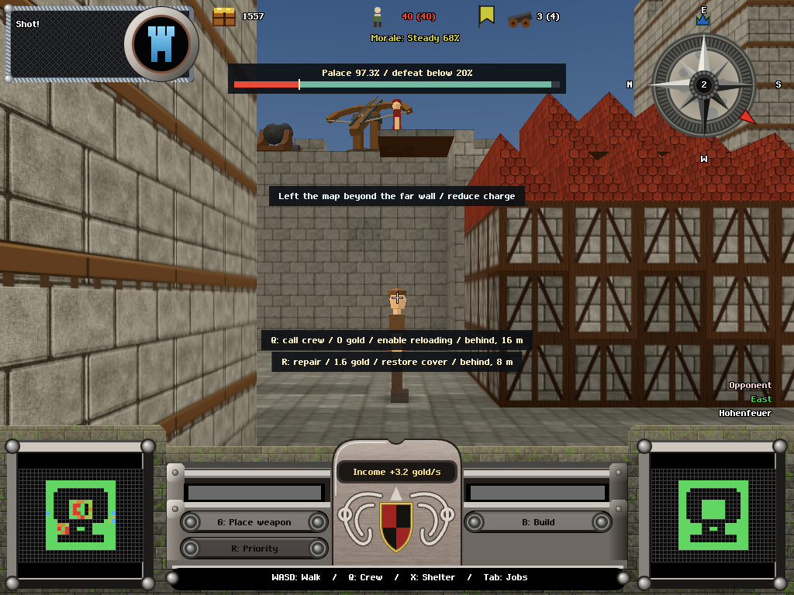
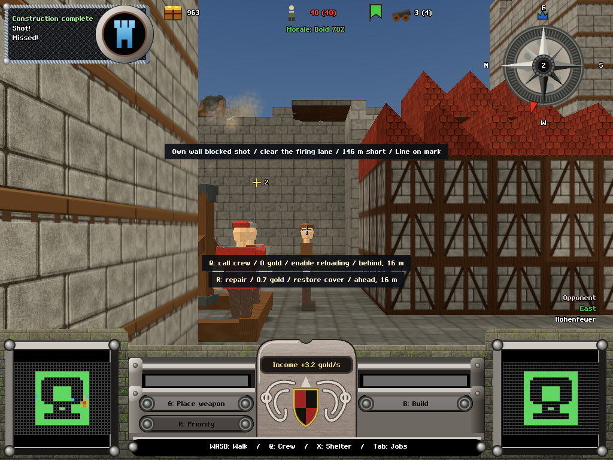
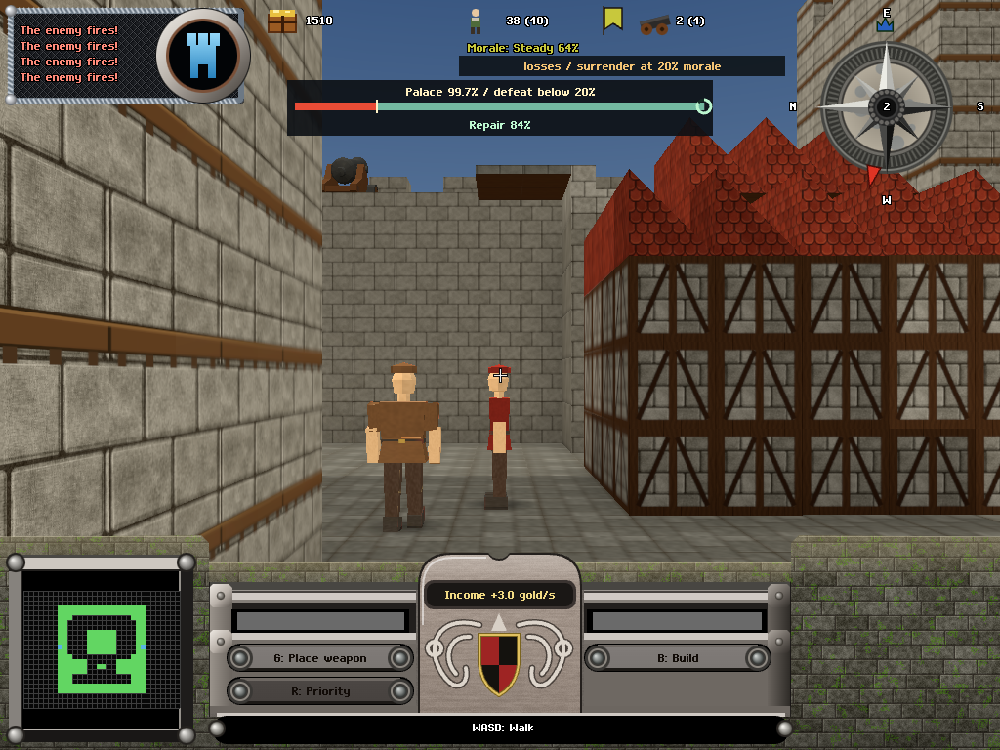

<!-- owns: repair-wave-3 UI implementation, paired screen measurements, visual evidence and remaining human acceptance. -->
# 24 — Repair wave 3, UI lane

2026-10-18. Scope: `castle-game-uo7.21`, the UI half of `.23`, `.24`, and the UI half of `.27`. The opening remains the research/18 progression ramp. No binding, permanent panel, compulsory intervention or simulation rule was added. No git command or `bd dolt push` was run.

## Changes

Reload guidance now uses physical order reach and the real picker/placement rules independently of camera visibility. A repair behind the camera is eligible; the line adds ahead/left/right/behind and distance. World markers still obey the viewport and mesh-occlusion checks, and retain their option number when another option is offscreen. Safety, palace health, gun readiness, recoverable masonry and material cost determine ranking. Already prioritised repairs, work that already has a mason, duplicate targets and nearby repairs with the same purpose, unavailable progression features and unaffordable orders are excluded. There are at most two alternatives. Palace repairs and repairs near a gun name that consequence; same-purpose repairs within three metres share one suggestion, with a distinct site eligible for the second. Idle diagnoses remain the fallback when there is no actionable suggestion.

`PROJECTILE_LOST` produces a terminal caption without an impact coordinate or signed offset. A far exit beyond the opponent's wall advises reducing charge; a known short exit says so; expiry or an unclassified disappearance says the shot was lost. The legacy fallback waits at most 60 simulation ticks after removal. The prior real impact ring is retained. Launch origin and aim-point arrays are now copied as well as the aim settings: changing aim during flight cannot rotate either signed axis. Own-wall obstruction, enemy-wall interception and palace damage are distinct. Palace damage checks the direction of the health change, so an enemy mason healing a palace cell in the same tick cannot mislabel an own-wall hit. The optional sim `hitKind` field is consumed; older collision strings and adjacent damage events remain supported.

A population line appears on the existing pressure surface at population <= 1.25 × the actual surrender threshold. It explicitly says **below**, preserving the strict comparison. It is independent of the morale unlock, including profile 0. The morale hold clock keeps its own line; an active surrender clock is also visible in match 1, while ordinary morale pressure and its gauge retain their unlock. Winning accounts now name the opponent's recorded elimination and its trigger: palace fraction/line, ruler death/cause, population count/threshold, or morale threshold/hold duration. A simultaneous ruler/population loss follows the recorded reason. Empty event headings are hidden.

An active palace repair gets one progress ring on the existing palace bar, with a short percentage label. It comes from the public repair job and palace-cell membership, requires a claimed job with actual progress and a working mason (when the NPC state is supplied), and disappears on completion. Queued, unreachable, unclaimed and unrelated jobs do not show a recovery marker. This exposes a repair beat; it does not establish that the measured palace plateaus feel engaging.

## Method and reproducibility

Evidence is in `tests/evidence/repair-wave-3-ui/`. The source snapshot in `snapshot.json` fixes the original simulation and novice policy while the other lane works. The separate `events-snapshot.json` adds the sim lane's terminal event/semantic impact fields for the shot cohort. These are recorded UI acceptance configurations, not a claim that the concurrently changing shared tree is frozen.

`scripts/wave3-screen.mjs` copies the critique-v3 screen-audit method. Both pickers see the same state and production camera at five seconds into every eligible >=10-second reload, across ten seeds each against AI 2/5/8. The independent candidates are still the v3 local-repair enumerator and threatened movement. Its 12-second counterfactuals retain normal commands, AI, costs and workers. Cached v3 candidate utilities are reused only when the complete sampled state hash matches; new candidates are rolled out afresh. This is the original audit's bounded defensive utility, not an optimal match-winning planner. Pilot trial utilities are also reused only at an identical sampled hash and for the same action. The pilot counts are not the final result. The proxy does not read the HUD; display coverage does not prove human discovery or increased decision density.

The original v3 result was **514 zero / 91 one / 0 two** across 605 windows, with **21/209 (10.0%)** beneficial-best coverage and zero placement failures. The paired current-picker measurements and verification results are recorded below when the runs finish.

## Evidence inventory

All browser captures use `tests/lib.mjs`, Chromium/SwiftShader, 1024×768, device scale 1. The reports distinguish actual replays, a controlled incoming-projectile repair fixture, and explicit HUD golden fixtures. The original catapult ledger uses `[30,1,24]` for shots 1–6 and resets at `[29,1,27]` for shots 7–20; the repeated cohort preserves both recorded setups. Cannon and ballista use uninterrupted 20-shot sequences.

| Surface | Before | After |
|---|---|---|
| Reload actions | `../critique-v3/shots/proxy-*`; original screen audit | `shots/proxy-*`; paired `screen-results.json` and `proxy-browser.json` |
| Lost shots | `../critique-v3/impact-browser.json`: seven missing ballista captions | `shots/impact-{cannon,catapult,ballista}-1.png` through `-20.png`; every shot captioned in `impact-browser.json` |
| Population trigger | `../critique-v3/shots/ai-seed6-last.png`, `ai-seed9-last.png` | `shots/seed{6,9}-before-shot-profile{0,3,10}.png`, last playable frames and end accounts |
| Winning cause | Previous winning screen without an account | `shots/seed1-win-profile10.png` |
| Palace recovery | `shots/palace-repair-before.png` | `shots/palace-repair-progress.png`, `shots/palace-repair-after.png` |

## Acceptance boundary

No unbriefed human study was performed. `.10`, `.13`, `.15` and all of `.28` remain open and unclaimed by this lane. The human portions of `.21`, `.23`, `.24` and `.27` remain open. This lane does not claim the four-shot chosen-point convergence test or the sim lane's pacing/plateau targets. A correct signed readout, a visible choice and a comprehensible choice remain different claims.

## Strings

Twenty-two new bilingual entries and one revised direction instruction are recorded in `strings.json`.

| Key | German | English |
|---|---|---|
| `optionRepairPalace` | R: Palast reparieren / {cost} Gold | R: repair palace / {cost} gold |
| `optionRepairGun` | R: am Geschütz reparieren / {cost} Gold | R: repair by gun / {cost} gold |
| `populationNear` | Bevölkerung {pop}, Aufgabe unter {line} | Population {pop}, surrender below {line} |
| `palaceRepair` | Reparatur {pct}% | Repair {pct}% |
| `shotLostFar` | Karte hinter der fernen Mauer verlassen / Ladung verringern | Left the map beyond the far wall / reduce charge |
| `shotLostShort` | Vor der Burg aus der Karte gefallen | Fell short of the map |
| `shotLost` | Geschoss verloren / kein Einschlag beobachtet | Shot lost / no impact observed |
| `impactOwnWall` | Eigene Mauer im Weg / Schussbahn freimachen | Own wall blocked shot / clear the firing lane |
| `impactEnemyWall` | Feindmauer getroffen / Schuss abgefangen | Enemy wall hit / shot intercepted |
| `winEliminated` | {name} ist ausgeschieden. | {name} was eliminated. |
| `winRuler` | {name} verlor den Herrscher. | {name} lost their ruler. |
| `winRulerCause` | {name} verlor den Herrscher durch {cause}. | {name} lost their ruler to {cause}. |
| `winPalace` | {name}: Palast bei {pct}%, unter der Niederlagelinie von {line}%. | {name}: palace at {pct}%, below the {line}% defeat line. |
| `winPalaceFallback` | Der Palast von {name} wurde zerstört. | {name}'s palace was destroyed. |
| `winPopulation` | {name} gab auf: Bevölkerung {pop}, unter {line}. | {name} surrendered: population {pop}, below {line}. |
| `winMorale` | {name} gab auf: Moral {s} s lang bei höchstens {line}%. | {name} surrendered: morale at or below {line}% for {s} s. |
| `winSurrender` | {name} hat aufgegeben. | {name} surrendered. |
| `optionDirection` | {dir}, {m} m | {dir}, {m} m |
| `optionAhead` | vorn | ahead |
| `optionLeft` | links | left |
| `optionRight` | rechts | right |
| `optionBehind` | hinten | behind |
| `leaveForOrder` | E: verlassen, zur Stelle drehen | E: leave gun, turn toward the site |

## Shot readout result

The repeated cohort is **60/60 captioned: 53 real impacts with independently correct signed offsets, plus seven honest lost-shot captions**. Every launch tick matches the v3 ledger, including its two catapult setups, and the aim changes during every flight. All seven formerly missing ballista shots are the same shots (14–20). They report an out-of-map exit on the removal tick (0 ticks of latency), have neither an impact point nor an offset, and preserve the previous real impact mark. `shot-summary.json` and the per-shot ledger record the assertions. The legacy event-free disappearance path is separately covered at its 60-tick deadline by the pure regression tests.

## Palace repair result

The controlled incoming-projectile fixture opens a ground-level route to one palace cell, then issues an ordinary priority repair. The cell goes **80 → 81 → 96 HP**, at ticks **96 → 110 → 161**. The bar shows **Repair 84%** at the intermediate frame and hides the repair marker when the cell is restored. Its material cost under the live repair rule is **1.0667 gold**; normal income continues. This is a recoverable individual-cell repair, not evidence that a threatened whole palace recovered or that a plateau feels better.

The initial upper-cell control `[25,3,22]` did not progress over 60 seconds: all six masons had path backoffs and the job remained unclaimed. The marker correctly stayed hidden. The successful `[25,1,22]` control and both job traces are in `palace-repair-probe.json`; the browser sequence is `palace-repair.json`. This distinction prevents a queued but inactive job from being presented as visible recovery.

The public repair fields in research/23 were checked when that report appeared: `jobs`, `claimedBy`, NPC `state`/`jobId` and palace cells are sufficient; no new sim field or invented progress is needed.

## Provisional scores — requested subset only

These are UI-lane judgments on the research/15 rubric, not a new independent 110-point review. Human-dependent acceptance is still unvalidated.

| Criterion | v3 | Provisional | Evidence and boundary |
|---|---:|---:|---|
| A1 Shot-cycle clarity | 4 | 4 | All 60 shots captioned; immutable signed axes and seven bounds exits verified. Chosen-point four-shot convergence is still open. |
| A2 Decision density | 3 | 3 | The paired planner audit measures improved displayed opportunity. The unchanged proxy ignores the HUD, so this does not demonstrate increased human decision density. |
| A4 Role load balance | 2 | 2 | Existing actions and progression gates are retained, with no compulsory chore. Human use and attention costs remain unmeasured. |
| C11 Rule consistency | 3 | 4 | Strict population threshold is visible before the fatal volley, including match 1; recorded elimination reason governs both accounts. Prediction study remains open. |
| D13 Impact/distance readability | 4 | 4 | Own obstruction, enemy interception, palace damage and lost shots are distinct. Distant visual/audio perception and precise aiming still need people. |
| D14 Threat telegraphing | 4 | 4 | Existing directional warning, ETA, deduplication and sound tests remain green; no new human listening claim. |
| E18 Repair vs rebuild | 4 | 4 | A paid palace-cell repair visibly advances 80→81→96 HP on the existing bar; inactive jobs stay hidden. Discovery and prioritisation remain U. |
| E19 Morale design | 3 | 3 | Population and morale triggers, plus the winning opponent's cause, are explicit. This does not establish recovery comprehension or change morale balance. |
